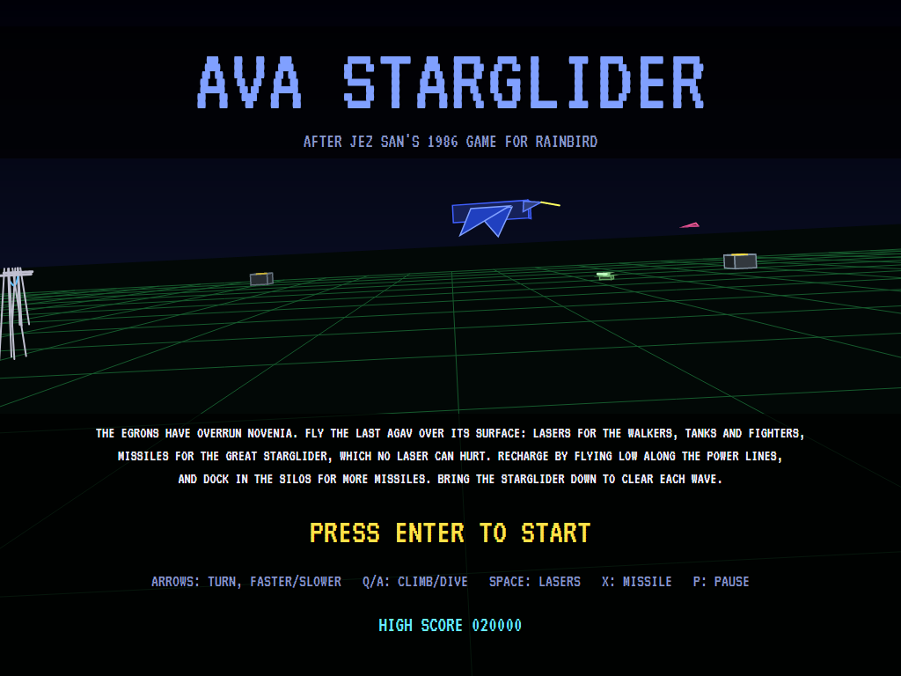
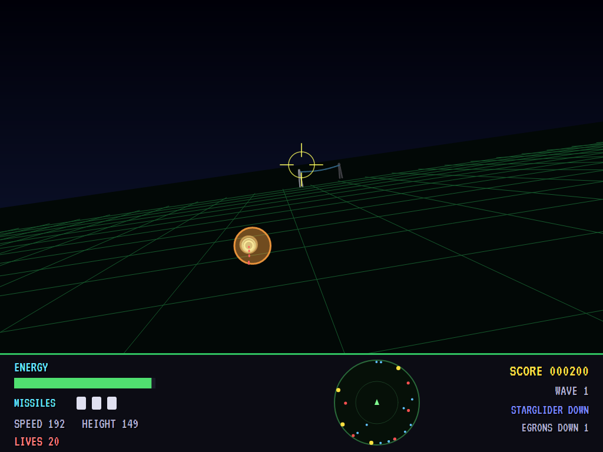
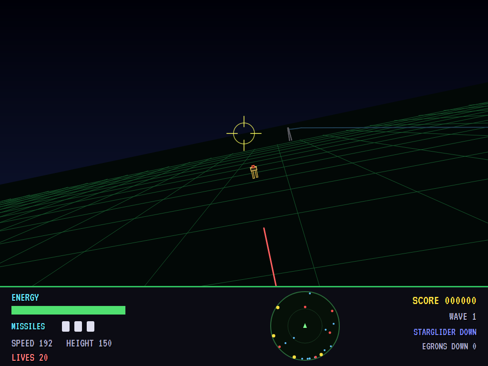
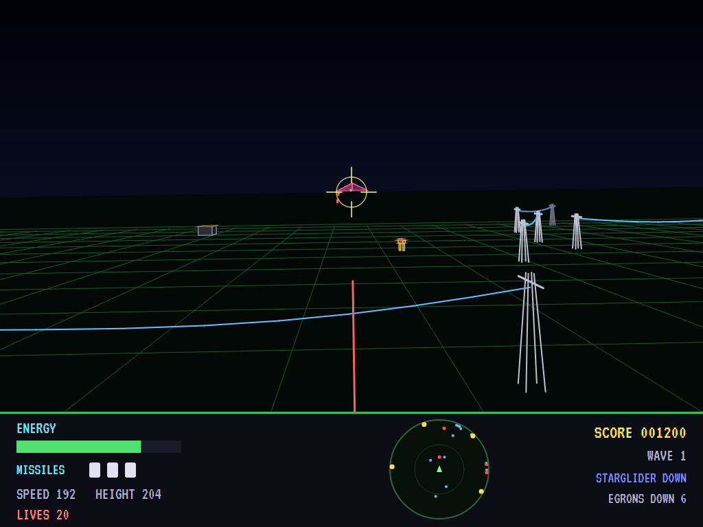
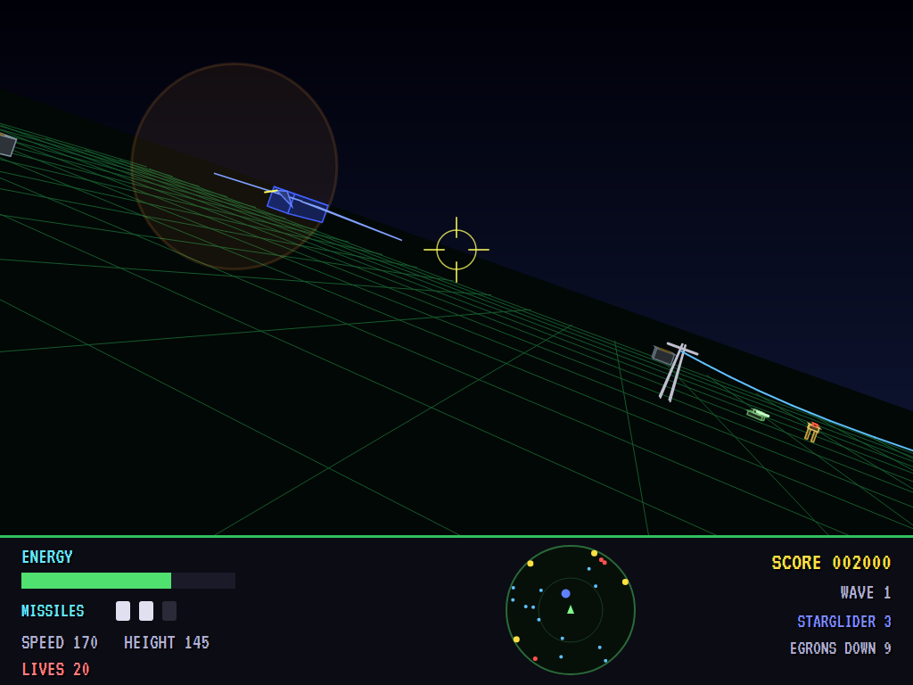
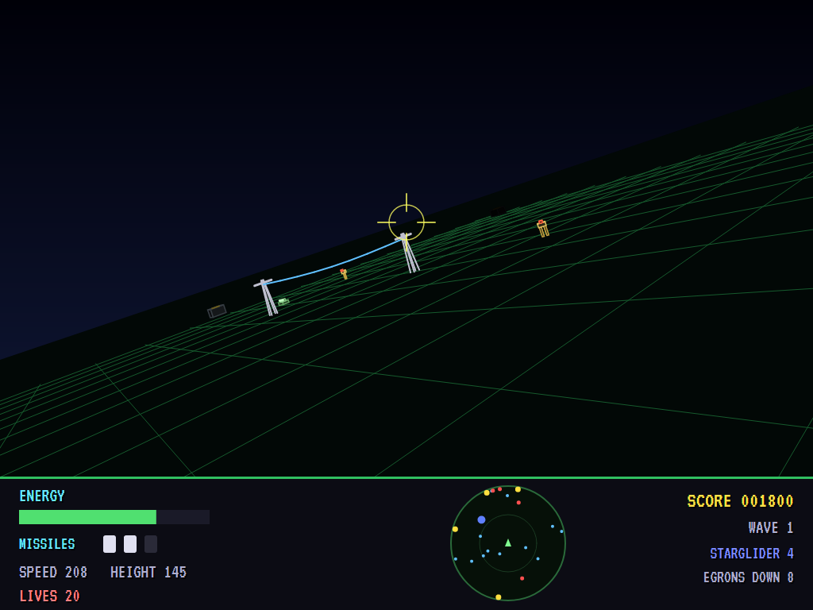
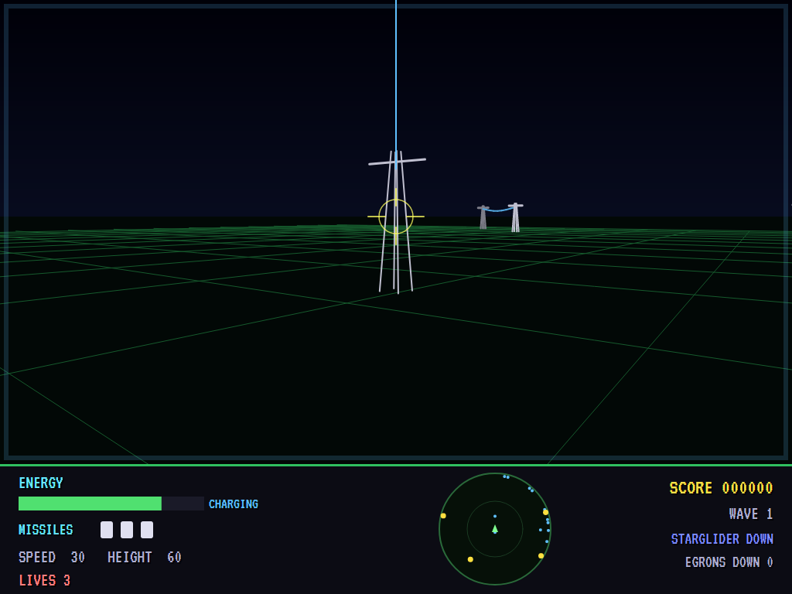
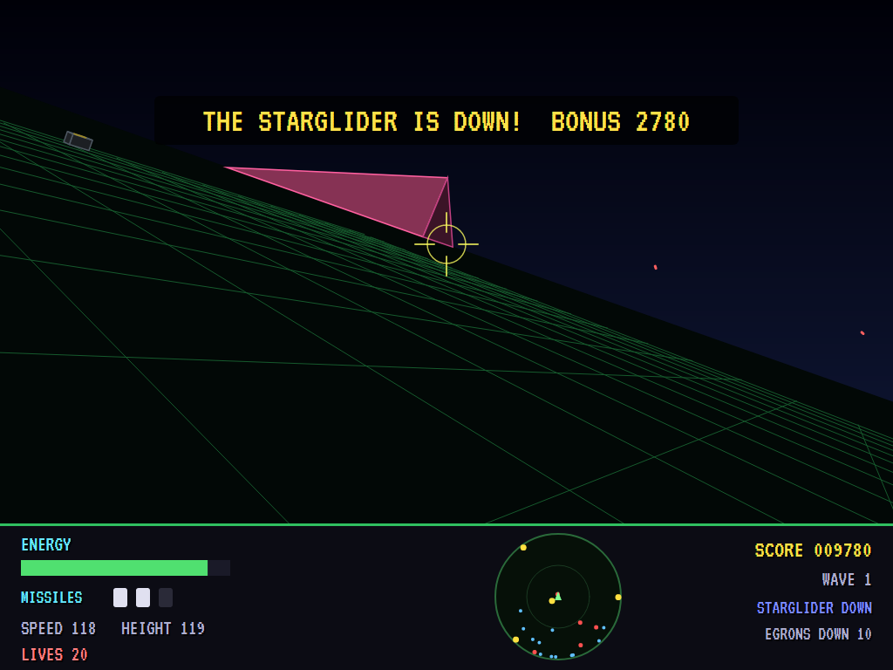
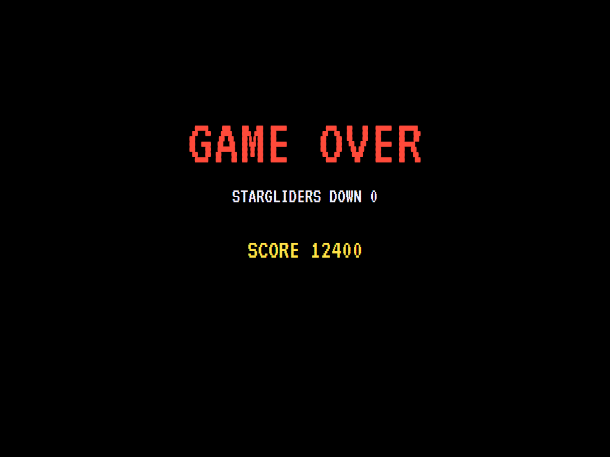
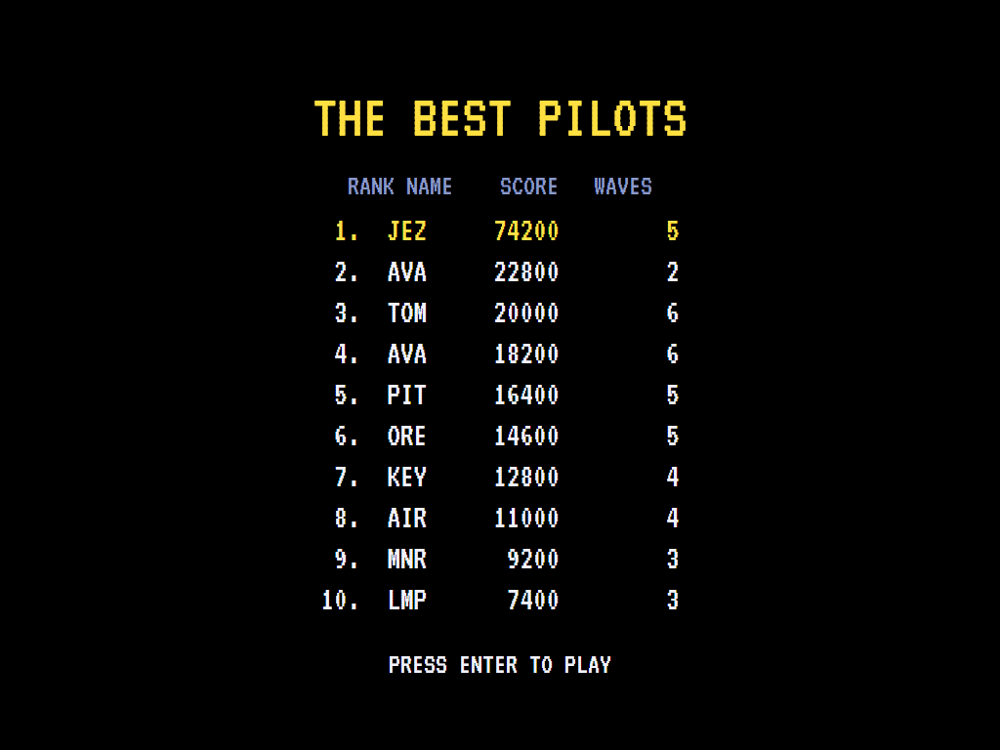

# AVA Starglider

[](https://github.com/Harlock123/AVAStarglider/actions/workflows/build.yml)

A 3D flying shooter over an alien world, in the style of Jez San's 1986 game **Starglider** for Rainbird. It's
built with .NET 10 and Avalonia UI. The Egrons have overrun Novenia, and you fly the last AGAV. Bring down their
walkers, tanks and fighters with your lasers. When enough of them are down the great Starglider comes, and only
missiles can hurt it. Recharge by flying low along the power lines, and dock in the silos for more missiles.

## Features

- **Solid 3D,** through the AGAV's canopy. A green grid on the ground runs out to the horizon, which tilts as
  you bank. Pylons carry sagging power lines, silos have glowing hatches, and the Egrons are drawn as shaded
  solids with bright edges. The surface wraps round at its edges.
- **The AGAV:** turn, speed up and slow down, climb and dive. Its lasers tip up or down onto whatever is near
  the line of fire. Each shot costs a little energy.
- **Missiles** home on the Starglider if it's anywhere ahead, or else the nearest Egron. They're slower and less
  nimble than their target, so they can miss. The AGAV carries three.
- **The Egrons:** walkers striding on long legs, tanks, delta-winged fighters that circle and dive at you, and
  the Starglider. It's a great bird, its wings beating, that only missiles can hurt. It takes four, and it
  swoops on the AGAV.
- **Energy** is spent by the lasers and lost to hits and collisions. Fly low between a power line's pylons,
  under the cable, to recharge. Dock low and slow over a silo's hatch for missiles and a little energy.
- **Waves:** bring down enough Egrons and the Starglider comes. Bring it down to clear the wave, with a bonus
  for the energy left. Each wave brings more Egrons, firing more often, and more to bring down first.
- **The cockpit panel:** energy, missiles, speed and height, and a radar with the pylons, silos, Egrons and the
  Starglider. Score, wave, and the Starglider's strength.
- **The attract mode** shows the computer pilot at work. It hunts the nearest Egron and fires once it's lined
  up, and turns on the Starglider with a missile when it can. It docks for missiles when it's out, and runs
  low under a power line when its energy is short.

## Screenshots

| The title | Over Novenia | A walker |
|:---------:|:------------:|:--------:|
|  |  |  |
| The Starglider, over the grid. | Pylons, silos and Egrons. | Lasers away. |

| A fighter | The Starglider | A missile |
|:---------:|:--------------:|:---------:|
|  |  |  |
| Coming round. | Only missiles will do. | Homing in. |

| Recharging | Starglider down | Game over |
|:----------:|:---------------:|:---------:|
|  |  |  |
| Low under the power line. | The wave cleared. | |



The screenshots are made by the tests, which play the game in a real (headless) window; see
[Tests](#tests).

## Download and run

Ready-to-run builds for Windows, macOS and Linux, on both Intel/AMD and ARM, are on the
[Releases page](https://github.com/Harlock123/AVAStarglider/releases/tag/latest). **Latest build** is
rebuilt on every push to `main`. Each download is one self-contained executable: no .NET install is
needed.

| Platform | Archive |
|---|---|
| Windows | `AVAStarglider-win-x64.zip`, `AVAStarglider-win-x86.zip`, `AVAStarglider-win-arm64.zip` |
| macOS | `AVAStarglider-osx-arm64.tar.gz` (Apple silicon), `AVAStarglider-osx-x64.tar.gz` (Intel) |
| Linux | `AVAStarglider-linux-x64.tar.gz`, `AVAStarglider-linux-arm64.tar.gz`, `AVAStarglider-linux-arm.tar.gz` |

```bash
tar -xzf AVAStarglider-linux-x64.tar.gz     # or linux-arm64, linux-arm, osx-arm64, osx-x64
./AVAStarglider
```

On Windows, unzip and run `AVAStarglider.exe`. On macOS, if Gatekeeper refuses to open it, run
`xattr -d com.apple.quarantine AVAStarglider` once. Run with `--no-audio` for silence.

**Sound** comes through OpenAL Soft, built in for every platform. In a virtual machine the game
detects it and uses a larger audio buffer, so the sound doesn't break up.

**Gamepads** use SDL2, which is bundled for Windows, macOS and Intel/AMD Linux. ARM Linux builds need it
installed; without it the keyboard still works:

```bash
sudo apt install libsdl2-dev            # Debian / Ubuntu / Raspberry Pi OS
sudo pacman -S --needed sdl2-compat     # Arch / Omarchy
```
## Controls

| Action | Keyboard | Gamepad |
|---|---|---|
| Start | Enter or 1 | Start |
| Turn | Left/right arrows | Left stick / D-pad |
| Faster / slower | Up / down arrows | Up / down |
| Climb / dive | Q, W or Page Up / A, S or Page Down | Right / left bumper |
| Lasers | Space, Z or Ctrl | A or right trigger |
| Missile | X or E | B or X |
| Pause | P or Esc | Start or Back |
| Sound on/off | M | |
| Screenshot | Ctrl+S (to your Pictures folder) | |

On the high-score table, type your initials, or use up/down and Space, then Enter.

## Tests

```bash
dotnet test AVAStarglider.slnx
```

The game runs in fixed 60 Hz steps, so it plays the same at any frame rate. Everything that moves lives in
one world that can be copied. The tests check:

- **Novenia:** power lines between pairs of pylons and silos well spread; each wave with more Egrons and more
  to bring down; the surface wrapping round.
- **Flying and fighting:** turning, speeding up and slowing, climbing and diving; lasers costing energy and
  bringing down a walker; lasers no use on the Starglider but missiles bringing it down; the Starglider coming
  once enough Egrons are down; energy coming back under a power line; docking for missiles; a pylon hurting;
  Egrons shooting, and the AGAV lost without energy.
- **The game:** the Starglider down, the bonus and the next wave; an AGAV lost, and the last one; the
  demonstration; pause; the keys.

`tests/AVAStarglider.Tests/PilotProbe.cs` reports how the computer pilot gets on over three waves, for tuning
(`SG_PROBE=1`). It clears each in about a minute. `SG_PROBE=lazy` flies in circles firing, and clears none.

The screenshot tests draw the real screen in a headless window. To refresh the README's pictures:

```bash
SG_SHOTS=$PWD/Images dotnet test tests/AVAStarglider.Tests --filter ScreenshotTests
```

## Building

```bash
dotnet build AVAStarglider.slnx
dotnet run --project src/AVAStarglider
```

Needs the .NET 10 SDK. The sounds, tunes and voice are made by `tools/make_sounds.py` (standard-library
Python, with the formant voice in `tools/speech.py`): `python3 tools/make_sounds.py` rewrites
`src/AVAStarglider/Sounds`. Both tunes are new compositions.

## Project structure

```
AVAStarglider/
├── AVAStarglider.slnx
├── src/AVAStarglider/
│   ├── Engine/
│   │   ├── GameEngine.cs        # States, AGAVs, waves in turn, bonuses, the title and demonstration
│   │   ├── Sim.cs               # The surface step by step: flying, lasers, missiles, Egrons, power lines, silos
│   │   ├── World.cs             # The AGAV and everything that moves, kept together so it can be copied
│   │   ├── Novenia.cs           # The surface: power lines, silos, and each wave's numbers
│   │   ├── Pilot.cs             # The computer pilot (the demonstration, and the tests)
│   │   ├── HighScoreTable.cs, InitialsEntry.cs
│   │   ├── InputHandler.cs, ControllerManager.cs  # Keys and an SDL2 gamepad
│   │   └── SoundManager.cs      # Effects, tunes and voice through OpenAL
│   ├── Audio/                   # The OpenAL engine (from the author's AVABand)
│   ├── Views/GameCanvas*.cs     # Novenia in 3D, the cockpit panel and radar, the title
│   └── Sounds/                  # The synthesised effects, tunes and voice
├── tests/AVAStarglider.Tests/   # Novenia, gameplay and screenshot tests
├── tools/make_sounds.py, tools/speech.py
└── Images/                      # Screenshots
```

## About and licence

AVA Starglider © 2026 Lonnie Watson, under the [MIT License](LICENSE).

*Starglider* © 1986 Rainbird (written by Jez San at Argonaut); the names *Starglider*, *Novenia*, *Egron* and
*AGAV* belong to their current owner. AVA Starglider is an independent, unofficial game in its style. Its world,
graphics, sounds, tunes and code are its own; nothing is taken from the original game's program, graphics or
sound. It is not affiliated with or endorsed by any rights holder.
